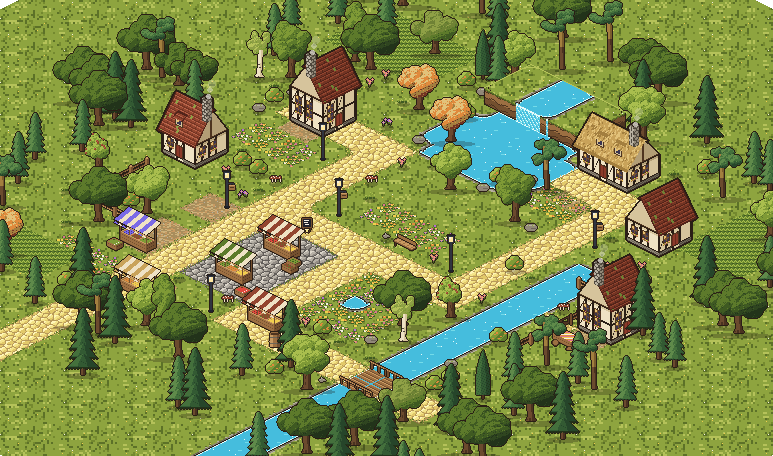

# tiny-town

A small map builder for pixel towns, isometric or top-down, made for drawing your own little world. It runs in the
browser with no install and no build step, and every tile, house, tree and stall is drawn in code (and can be
repainted by hand).

**Try it: https://tinypixeltown.com** (it opens the Market village example)



## Start here

* **Paint** the ground (grass, paths, cobbles, water, dirt, crops), raise hills and dig pits, add stairs, fences and
  gates, flowers and tall grass: pick a swatch in the Paint panel on the left and brush. The grass runs on forever:
  paint anywhere and the map grows.
* **Place** houses, market stalls, trees and more: drag them in from the Objects panel on the right. Scatter sprinkles
  trees and flowers.
* **Walk** (Enter) your town with the arrow keys, then go straight back to building.
* **Save** a `.ldtk` map (it also opens in [LDtk](https://ldtk.io)). The arrow beside Save holds the rest: save a PNG,
  copy a **share code** (the whole map as one line of text to send to a friend), open a file or a code, examples.
* Switch **Iso / Top** in the middle of the top bar. Your map is kept in your browser as you work.

## Running it

The page loads its tiles with `fetch`, so open it through any small web server, not as a file:

```bash
python3 -m http.server 8000
```

then visit http://localhost:8000. Your map is kept in the browser as you work; **Save** writes a `.ldtk` file.

| Do | How |
|---|---|
| Paint | Pick a swatch (or keys 1-9) and brush; pick it again or press Esc to put the brush down. The size (1, 2, 3 or `[` `]`) is beside it in the toolbox; fences, gates and stairs are always one cell. The Eraser (E, beside the toolbox, or right-click) takes away everything it touches: ground, fences, stairs, hills and pits, and whole buildings and objects. Alt-click takes the swatch under the cursor, Shift-click draws a straight line from the last stroke. The grass runs on forever: paint anywhere and the map grows to reach it. |
| Height | Raise, Lower and Flatten (to the level where the stroke starts). Lower digs below the ground too: the map lifts a level to make room, so a pit or a sunken pond looks dug in. Neighbours are nudged so side-by-side cells are never more than one level apart. |
| Stairs | Stairs go at the foot of a cliff that faces you (just south or just east of higher ground); painting on the cliff's top steps down to its foot, and the brush turns red where none can go. |
| Place | Drag a prop or character from the Objects panel onto the map, or click it and then the map (Shift keeps placing). With no tool active (Esc, or click the active tool again): click an object to select it, drag to move it, arrows nudge; the card beside it has Duplicate and Delete. Pick Few, Some or Lots under Scatter and drag to sprinkle trees or bushes; right-drag clears them. |
| Reuse | New stamp (in Stamps): drag over part of the map, name it, save. Pick a stamp to place it again; Esc stops. |
| Share | The arrow beside Save: Copy share code (the whole map as one line of text, a few KB), or Open a share code. |
| Walk | Walk (or Enter): walk the town with the arrows or WASD; stairs climb, water and fences block. Esc stops. |
| Phone | Paint and Objects open as sheets from the toolbox. Hold still to pick. |
| Move around | Wheel or two fingers to pan, Ctrl+wheel or pinch to zoom, drag the ground with no tool active, or hold Space and drag. Shift+1 fits the map. |
| Settings | The cog: what to show (props, grid, the forest round the edge) and every shortcut. Shift+R shows the raw grid, like LDtk. |

## Map files

Maps are saved as `.ldtk` files: a small subset of [LDtk](https://ldtk.io)'s documented JSON format (version 1.5.3),
so they can also be opened in LDtk and read by its loaders.

| Layer | Kind | Holds |
|---|---|---|
| `Terrain` | IntGrid | grass, path, cobbles, water, crops, forest floor, bridge |
| `Height` | IntGrid | 0 to 4 (levels) |
| `Features` | IntGrid | stairs |
| `Deco` | IntGrid | fence, flowers, tall grass, gate |
| `Objects` | Entities | trees, houses, props, characters, paths, regions |

## Folders

| Path | What |
|---|---|
| `art/` | Python (Pillow) that draws the art: `dualgrid.py` (tile shapes), `styles.py` (every look), `props.py`, `tiles.py` (builds the sheets), `preview.py` (style comparisons), `ldtk.py` (writes maps), `builtin_stamps.py` (the ready-made stamps) |
| `tiles/` | The tile sheet (`tileset.png` + `tileset.json`), the prop atlas (`props.png` + `props.json`), and `tileset.edited.png`, your hand edits (they win) |
| `index.html`, `js/` | The editor: `editor.js` (the page), `tools.js` (painting, fill, height, plots, undo), `stamps.js` (copy, paste, stamps), `share.js` (share codes), `walk.js` (walk mode), `files.js` (open, save, autosave), `registry.js` (what can be painted and placed), `format.js` (load/save maps), `render.js` (draws a map) |
| `maps/` | Example maps |
| `sprites/` | Example characters (one PNG each, feet at the bottom centre) |

## Regenerating the art

Needs Python 3 and Pillow (`pip install pillow`).

```bash
python art/iso_tiles.py earthy
```

writes `tiles/iso/` (the isometric sheet and props); `python art/tiles.py` writes the top-down `tiles/`.
`python art/reference_town.py` rebuilds the Market village example, and `python art/render_map.py <map.ldtk> <out.png>`
draws any map. `CLAUDE.md` explains how the code fits together.

## Repainting tiles

Make `tiles/tileset.edited.png` the same size as `tiles/tileset.png` (copy it, then erase every tile you don't change)
and paint in your pixel editor (Aseprite, Pixelorama, Piskel, even Figma). Any 16x16 tile in the edited sheet that isn't
fully transparent replaces the generated one when the page loads, so regenerating the art never overwrites your edits.

## Roadmap

1. Repo skeleton (done)
2. Tile sheet drawn in code, picked in rounds (done)
3. Map format, renderer and an example map (done)
4. The editor: paint, height, stairs, entities, undo, save/open, export PNG (done)
5. Polish the example town
6. Publish it (done: tinypixeltown.com)

## Ideas, next up

The builder draws isometric (32x16 diamonds, levels 16 px high) or top-down; the Market village example rebuilds a
storybook reference picture from these parts. Done from research and that reference: height levels, Shift-lines,
scatter, stamps, plots, share codes, walk mode, a phone tool bar, isometric houses (storybook look), market stalls,
lamps, fences, bridges, stairs, flower beds, dirt, details, a light wood round the town, chimney smoke.

Still open:

* More houses and buildings (a mill, a tavern, a chapel), more stall goods, carts.
* Sounds (off by default), per-terrain cliff lips, a darker roof option.
* Characters drawn for the isometric angle (the cast sprites are still straight-on).

## License

Code: MIT (`LICENSE`). Art: CC BY 4.0 (`LICENSE-art`).
